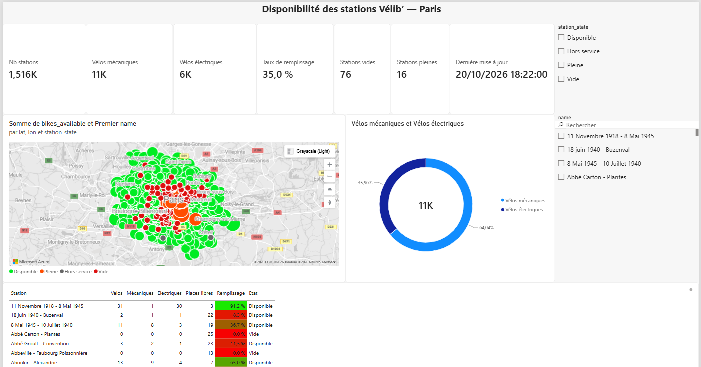
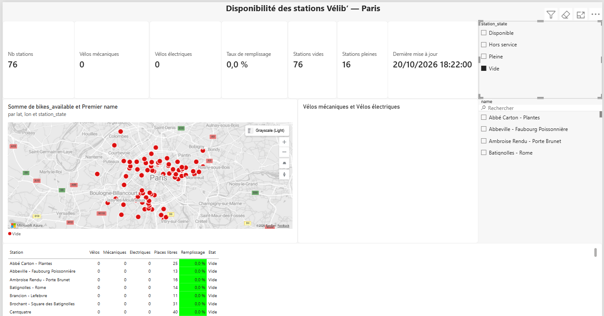

# 🚲 Vélib' Dashboard : disponibilité des stations à Paris

Pipeline de données de bout en bout qui récupère en temps réel l'état des ~1 500 stations Vélib' Métropole, le nettoie, le stocke dans PostgreSQL et l'affiche dans un tableau de bord Power BI.



## 🎯 But du projet

Répondre à des questions simples pour un usager ou un gestionnaire du réseau :

- Combien de vélos **mécaniques** et **électriques** sont disponibles en ce moment ?
- Quelles stations sont **vides** (impossible de prendre un vélo) ou **pleines** (impossible d'en déposer un) ?
- Quel est le **taux de remplissage** de chaque station et du réseau ?

Exemple de relevé (20/10/2026, 18h22 UTC) : 1 516 stations, 76 vides, 16 pleines, taux de remplissage global de 35 %.

## 🏗️ Architecture

```
API open data Vélib' (GBFS)
        │  requests
        ▼
  extract.py   →  transform.py   →   load.py
  (récupération)  (nettoyage Pandas)  (upsert SQLAlchemy)
                                         │
                                         ▼
                          PostgreSQL 17 (Docker)
                          tables + vues SQL
                                         │
                                         ▼
                              Power BI Desktop
```

| Étape | Fichier | Rôle |
|---|---|---|
| Extract | `src/extract.py` | Télécharge les flux GBFS `station_information` et `station_status` |
| Transform | `src/transform.py` | Aplatit les types de vélos, convertit les dates, nettoie les colonnes |
| Load | `src/load.py` | Insère les données dans PostgreSQL sans créer de doublons |
| Orchestration | `src/pipeline.py` | Enchaîne les trois étapes, avec des logs |
| Schéma | `sql/init.sql` | Tables `stations` (dimension) et `station_status` (faits) |
| Indicateurs | `sql/views.sql` | Vues `v_status_history` et `v_latest_status` lues par Power BI |

## 🛠️ Stack

Python 3 · Pandas · SQLAlchemy · PostgreSQL 17 · Docker Compose · Power BI · Git

## 💡 Choix techniques

- **Modèle dimension / faits** : `stations` contient les données qui changent rarement (nom, position, capacité) et `station_status` une ligne par station et par relevé.
- **Pipeline idempotent** : la clé primaire `(station_id, collected_at)` et les requêtes `ON CONFLICT` permettent de relancer le script sans créer de doublon. Les stations sont mises à jour (upsert) et les relevés déjà présents sont ignorés.
- **Qualité des données dans la base** : clés étrangères, contraintes `NOT NULL` et `CHECK (>= 0)`. Une ligne invalide est refusée et la transaction est annulée.
- **Règles métier en SQL** : le taux de remplissage et l'état des stations (Vide, Pleine, Disponible, Hors service) sont calculés une seule fois, dans des vues versionnées. Power BI ne fait que les afficher.
- **Taux de remplissage réaliste** : il est calculé sur `vélos + places libres` plutôt que sur la capacité théorique, car certaines bornettes peuvent être hors service.
- **Secrets hors du code** : les identifiants sont dans un fichier `.env` qui n'est pas versionné. Un modèle est fourni dans `.env.example`.

## 🚀 Lancer le projet

### Prérequis

- Python 3.10+
- Docker Desktop
- Power BI Desktop (Windows), pour le tableau de bord

### 1. Cloner et installer

```powershell
git clone https://github.com/<rmekrant>/velib-dashboard.git
cd velib-dashboard
python -m venv .venv
.venv\Scripts\Activate.ps1
pip install -r requirements.txt
```

### 2. Configurer les identifiants

```powershell
copy .env.example .env
```

Puis ouvre `.env` et choisis un mot de passe.

### 3. Démarrer PostgreSQL

```powershell
docker compose up -d
docker compose ps
```

Attends le statut `(healthy)`. Au premier démarrage, les tables et les vues sont créées automatiquement.

> PostgreSQL est exposé sur le port **5433** pour ne pas entrer en conflit avec une installation locale de PostgreSQL sur le port 5432.

### 4. Lancer le pipeline

```powershell
python src/pipeline.py
```

Résultat attendu :

```
INFO | 1517 stations, 1517 statuts récupérés
INFO | Nouveaux relevés enregistrés : 1517
```

Si tu relances le script dans la même minute, il affiche `Nouveaux relevés enregistrés : 0`. C'est l'idempotence.

### 5. Ouvrir le tableau de bord

Ouvre `dashboard/velib_dashboard.pbix` dans Power BI Desktop, puis clique sur **Actualiser**.
Connexion : serveur `127.0.0.1:5433`, base `velib`, identifiants de ton fichier `.env`.

## 📊 Le tableau de bord

- **Indicateurs clés** : nombre de stations, vélos mécaniques et électriques, taux de remplissage global (moyenne pondérée), stations vides et pleines, heure du dernier relevé
- **Carte** des stations colorées selon leur état
- **Répartition** vélos mécaniques / électriques
- **Tableau** des stations avec mise en forme conditionnelle du taux de remplissage
- **Filtres** par état et par nom de station

Exemple : le tableau de bord filtré sur les stations vides.



## 🗺️ Prochaines étapes

- [ ] Collecte automatique toutes les 15 minutes, pour construire un historique
- [ ] Orchestration avec Apache Airflow (dans Docker)
- [ ] Tests unitaires avec pytest et contrôles de qualité des données

## 📄 Données

Source : [Vélib' Métropole, disponibilité en temps réel](https://www.data.gouv.fr/fr/datasets/velib-velos-et-bornes-disponibilite-temps-reel/), au format GBFS, sous licence [ODbL](https://opendatacommons.org/licenses/odbl/).
